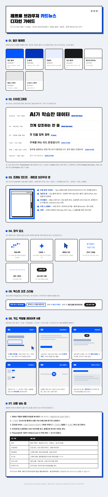
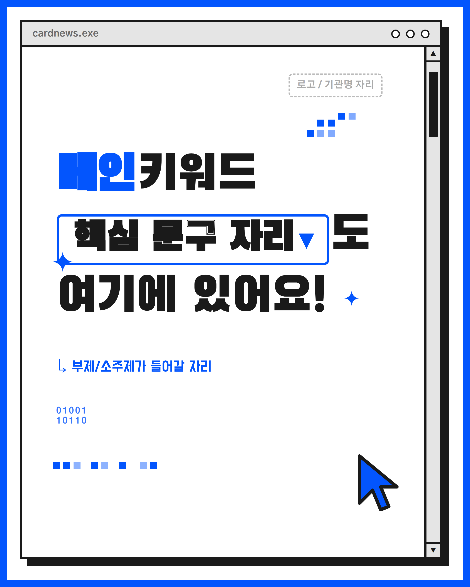
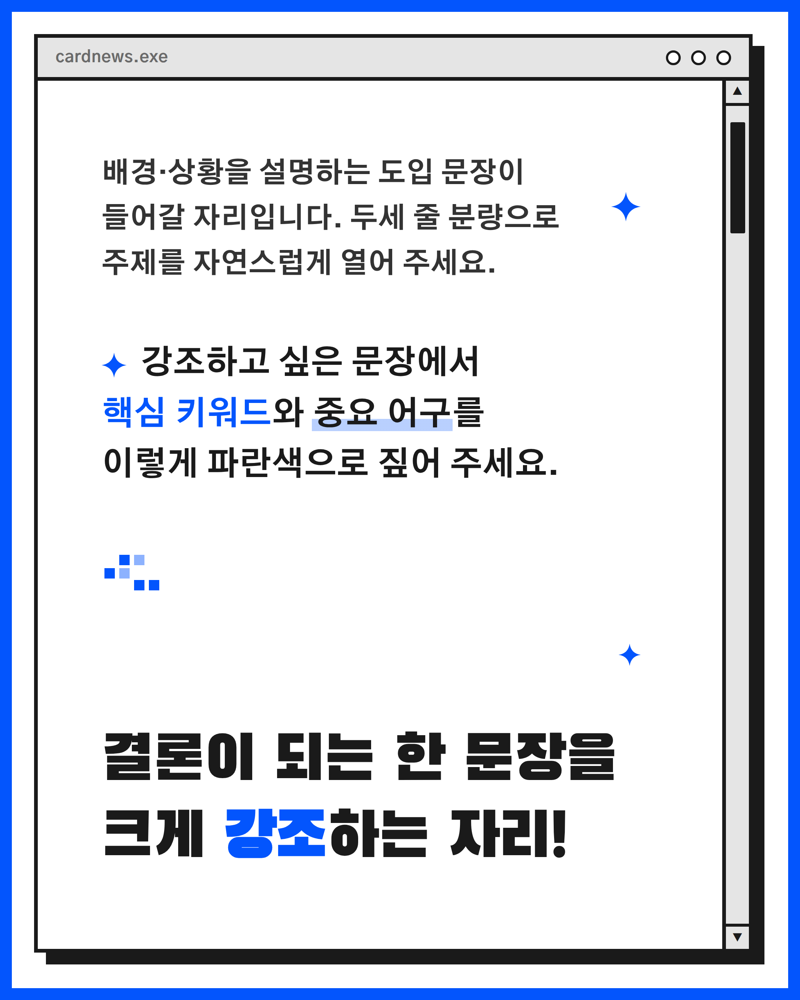
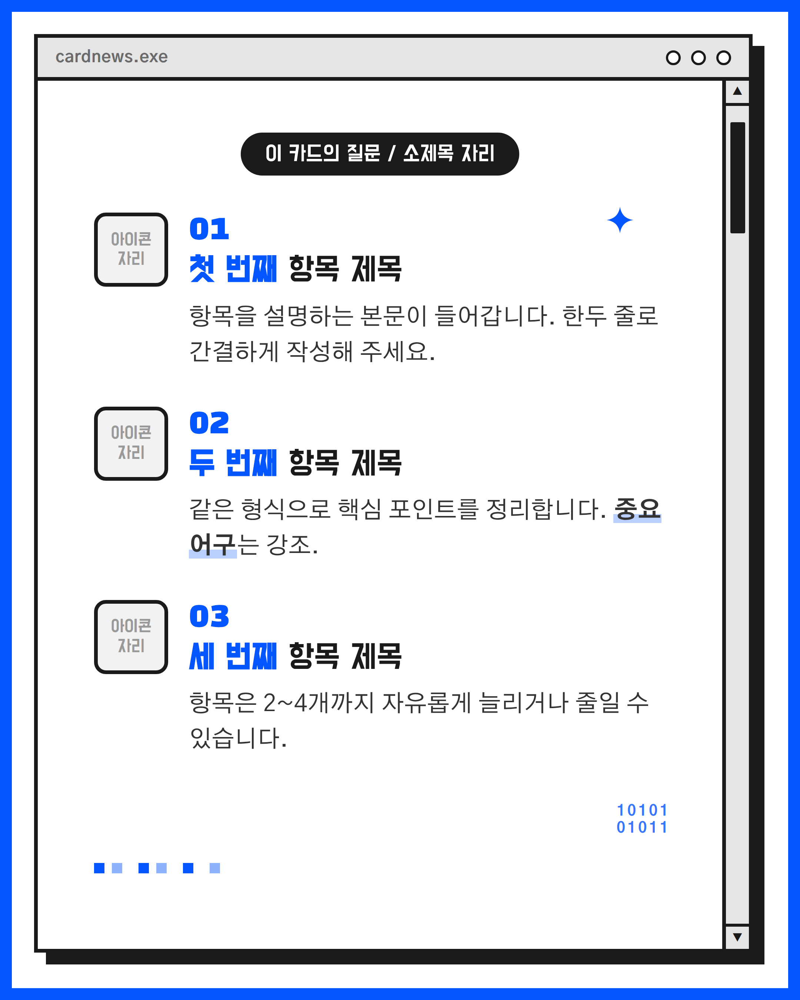
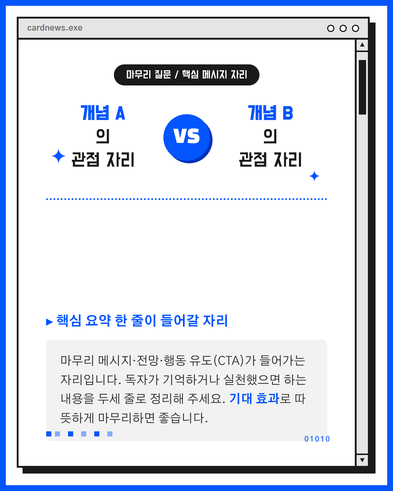

# 레트로 브라우저 블루 카드뉴스 디자인 시스템

인스타그램/카드뉴스용 **1080 × 1350px** 세로형 카드 디자인 시스템입니다.
흰 바탕 위 레트로 브라우저 창(타이틀바 + 점 3개 + 스크롤바)을 모티프로,
코발트 블루 한 가지 포인트 컬러와 픽셀·스파클·2진수 같은 레트로 장식으로
통일감 있는 카드 세트를 빠르게 만들 수 있도록 설계했습니다.

## 전체 미리보기



> 위 이미지는 `design-guide.html`을 렌더링한 전체 가이드 미리보기입니다.
> 컬러/타이포/강조요소/장식 규칙을 한눈에 볼 수 있습니다.

## 컬러 팔레트

| 변수 | HEX | 용도 |
|------|-----|------|
| `--blue` | `#0355FD` | 메인 코발트 블루 (포인트) |
| `--blue-deep` | `#0033B8` | 깊은 블루 (그림자/보조) |
| `--blue-soft` | `#E6EEFF` | 연한 블루 배경 |
| `--ink` | `#1A1A1A` | 텍스트 · 테두리 블랙 |
| `--paper` | `#FFFFFF` | 카드 배경 흰색 |
| `--panel` | `#E5E5E5` | 타이틀바 · 회색 박스 |
| `--panel-soft` | `#F2F2F2` | 연회색 콘텐츠 박스 |

포인트 컬러는 **블루 하나만** 사용하는 것이 핵심입니다. 강조가 필요한 곳에만
블루를 쓰고 나머지는 흑/백/회색으로 두면 레트로 브라우저 느낌이 살아납니다.

## 폰트

CDN(Google Fonts / Pretendard)으로 자동 로드됩니다. (`frame.css` 상단 `@import`)

- **Black Han Sans** — 디스플레이/대형 타이틀 (`.display`)
- **Jua** — 둥근 느낌 강조 (`.round`)
- **Do Hyeon** — 서브 타이틀 · 알약 라벨 · 아이콘 (`.sub`)
- **Gothic A1 / Pretendard** — 본문 기본 (본문 최소 28px 가드레일)

## 4종 레이아웃

| 파일 | 유형 | 용도 |
|------|------|------|
| `templates/template-01-cover.html` | **표지형 (Cover)** | 첫 장. 대형 메인 키워드 + 핵심 문구 박스 + 부제 훅(↳) + 로고 슬롯 |
| `templates/template-02-body.html` | **본문형 (Body)** | 도입 문단 → 강조 포인트 문단 → 하단 펀치라인(큰 결론 한 줄) |
| `templates/template-03-list.html` | **리스트형 (List)** | 상단 질문 알약 + 번호(01~) 항목 목록. 항목은 2~4개 자유 증감 |
| `templates/template-04-cta.html` | **마무리형 (CTA)** | VS 비교 + 점선 구분 + 회색 박스 마무리 메시지/행동 유도 |

모든 레이아웃은 동일한 `frame.css`를 공유하며, 바깥 블루 프레임 → 검정 테두리
브라우저 창 → 타이틀바(`cardnews.exe` + 점 3개) → 콘텐츠 + 우측 스크롤바
구조를 공통으로 씁니다.

### 샘플 미리보기

| 01 표지형 | 02 본문형 |
|:--:|:--:|
|  |  |

| 03 리스트형 | 04 마무리형 |
|:--:|:--:|
|  |  |

## 내용 넣는 법

1. **만들 장수만큼 템플릿을 복사**합니다. 보통 `01-cover → 02-body / 03-list → 04-cta`
   순서로 4~6장을 구성합니다. 같은 유형을 여러 장 반복해도 됩니다.
2. 각 파일 안에 `<!-- ... 자리 -->` 주석과 "메인 키워드", "핵심 문구 자리",
   "아이콘 자리" 같은 **플레이스홀더 텍스트를 실제 내용으로 교체**합니다.
   HTML 구조/클래스는 그대로 두세요.
3. **강조는 아래 유틸리티 클래스**로 입힙니다. (정의는 `frame.css`)
   - `c-blue` — 글자만 파랗게
   - `u-blue` — 파란 밑줄 하이라이트
   - `k-blue` — 파란 박스(흰 글씨) · `k-box` — 흰 박스(파란 테두리), `.caret`로 ▾ 추가
   - `pill` — 검정 알약 라벨 · `graybox` — 회색 콘텐츠 박스 · `num` — 리스트 번호
4. **장식 요소**(`.deco` 픽셀 트레일 / 스파클 / 2진수 / 레트로 커서)는 분위기용이므로
   위치만 조정하거나 과하면 지워도 됩니다. 블루 포인트 양을 일정하게 유지하는 게 요령.
5. **본문은 28px 이상**(`t-body` 등 스케일 클래스 사용)으로 유지해 가독성을 지킵니다.
6. **이미지로 내보내기**: 브라우저에서 HTML을 열고 `.card`(1080×1350) 영역을
   스크린샷하거나, 헤드리스 렌더링 도구로 캡처합니다.

> 참고용 전체 사용 설명은 `design-guide.html`을 브라우저로 열어 확인하세요.

## 파일 목록

```
design-guide/
├── README.md                         이 문서
├── design-guide.html                 디자인 가이드 전체 문서 (브라우저로 열기)
├── guide-preview.png                 가이드 전체 렌더 미리보기
├── design-guide-and-templates.zip    가이드 + 템플릿 5종 한 번에 받기
├── templates/
│   ├── frame.css                     공통 프레임/타이포/강조/장식 스타일
│   ├── template-01-cover.html        표지형
│   ├── template-02-body.html         본문형
│   ├── template-03-list.html         리스트형
│   └── template-04-cta.html          마무리형(CTA)
└── samples/
    ├── sample-01.png ~ sample-04.png 4종 레이아웃 렌더 샘플
```

## 다운로드

- **디자인 가이드 HTML**: [`design-guide.html`](design-guide.html)
- **템플릿 + 가이드 전체 ZIP**: [`design-guide-and-templates.zip`](design-guide-and-templates.zip)
  - 압축을 풀면 `design-guide.html`과 `templates/` 폴더(frame.css + 4종 HTML)가
    같은 상대경로로 들어 있어 바로 열어 쓸 수 있습니다.
